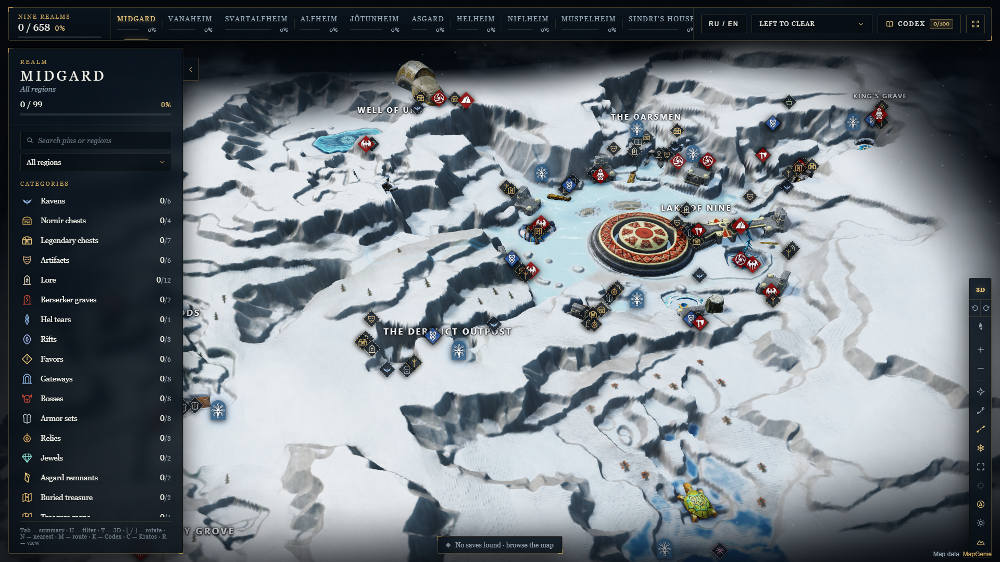
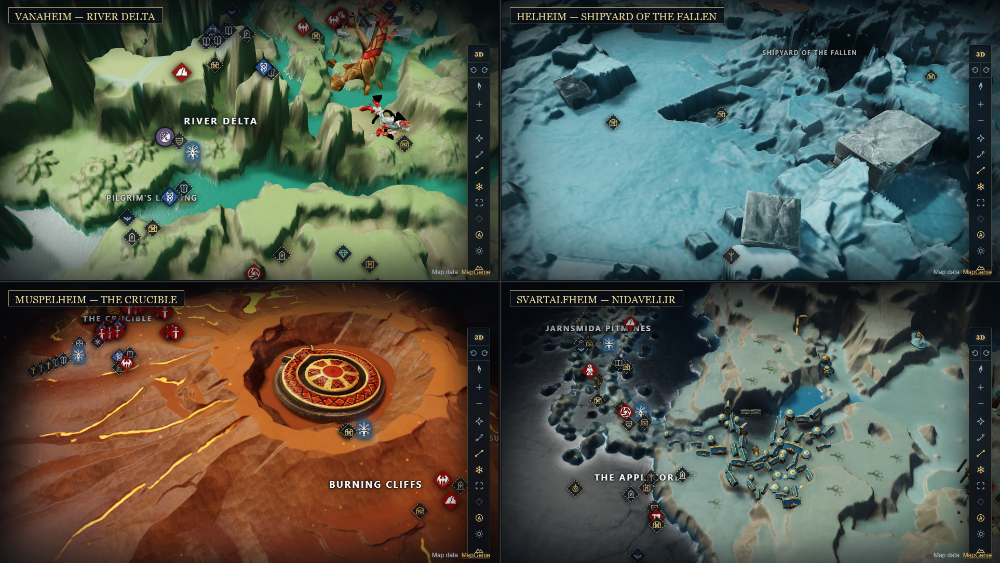
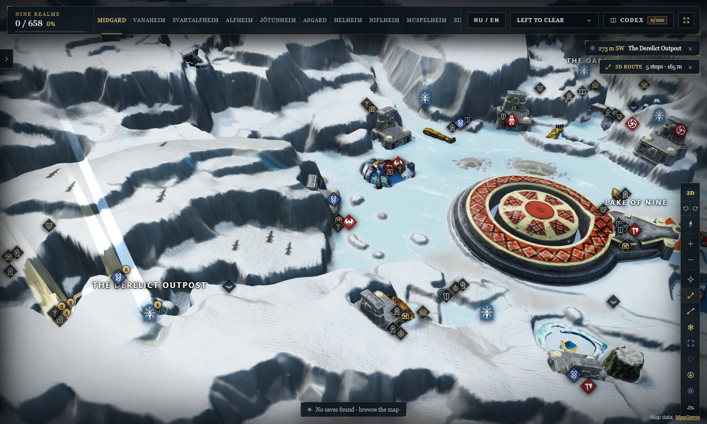
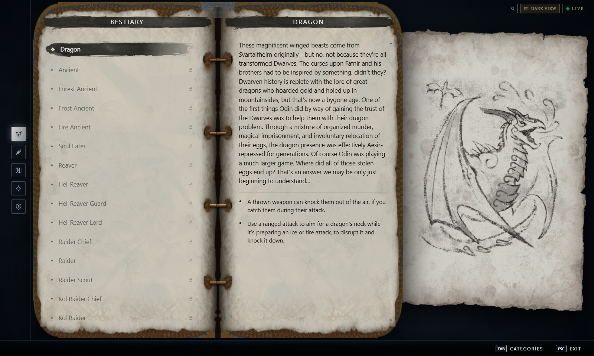

# God of War Ragnarök — Companion Map

[Русский](README.ru.md) · **Version 0.5.0** · MIT License · Steam Guides: [English](https://steamcommunity.com/sharedfiles/filedetails/?id=3840431796) · [Русский](https://steamcommunity.com/sharedfiles/filedetails/?id=3840415927)

A fullscreen **Native 3D diorama map**, **universal 3D navigator**, and **live Open-Book Codex & Bestiary** for the Steam PC version of **God of War Ragnarök** — built for a second monitor, tablet, or phone over Wi-Fi/LAN with zero external web dependencies.



> *All screenshots show the companion running locally with data extracted on the user's PC from an installed Steam copy of the game and public MapGenie pin coordinates. No saves, personal identifiers, or game assets are bundled in this repository. Game artwork and map data belong to their respective rights holders.*

---

## Showcase

### All 9 Realms in Native 3D (Reverse-Engineered In-Game Diorama)

When a local Steam installation of **God of War Ragnarök** is present, the companion reconstructs each realm's authentic carved wood-and-stone 3D world map — complete with 3D landmark meshes, PBR normal/gloss/alpha-cutout atlases, 2K raymarched cliff self-shadows, real-time 2048px directional shadow maps, animated rivers and molten lava flowmaps, carved tree decals, volumetric mist, and realm-specific 3D weather.



### Universal 3D Routing, Clearing Routes & Built-In Guides

Plot a terrain-draped golden 3D route to **any target** — Nornir chest, Odin's Raven, Favor objective, Buried Treasure, or Boss — starting from live Kratos (updating as you walk) or from the nearest unlocked Mystic Gateway, including automatic cross-realm jumps. Press **M** to chain up to 5 nearest uncollected completion pins into an auto-updating **3D Clearing Route**, or **N** to beacon the single nearest missing collectible.



### Authentic In-Game Open-Book Codex & Live SSE Sync

Press **K** (or tap **Codex**) to open an authentic stitched leather-and-parchment journal spread (with a 1-click **Book / Dark view** toggle): full **Bestiary** (198 entries + Valhalla DLC toggle, 9 categories, combat tips, family kill counters, hand-drawn ink sketches on the fold-out flap), **Lore** (~209 entries), **Treasures** (all 10 Treasure Maps with 3-state save tracking, riddles, clue paintings, and 1-click scroll/dig routing), **Skill Labors** (49 weapon skills + *"Closest to next rank"* strip), and **Hero Loadout & Crafting Materials**. Built-in **Anti-Spoiler** hides locked entries until unlocked or revealed, and Server-Sent Events (`/api/stream`) push newly unlocked entries live as soon as the game autosaves.



---

## How It Works

The companion runs a lightweight local Python server (`server.py`, strictly read-only) that combines three layers entirely on your own computer:

1. **Native 3D Game Diorama (Local Read-Only Extraction)**
   - Reads `exec/wad/pc_le/r_ui.wad`, `root.lodpack`, and `root.texpack` from your local Steam installation without modifying a single game file.
   - Extracts each realm's 3D landmark sub-meshes (`MESH_<realm>_0` → compact binary `props.bin`), packs synchronized PBR diffuse (`RGBA` with BC7 alpha cutouts for foliage/blossoms) + tangent-normal/gloss atlases, decodes full-precision BC6H heightmaps into 16-bit `1024×1024` GPU heightmaps (`<realm>_h16.png`), and renders 2K carved-wood diorama surfaces with 36-step raymarched cliff shadows and water/lava masks.
   - Serves textures automatically as **WebP + gzip** (~4.6 MB per realm instead of ~22 MB PNG) for fast, fluid loading on tablets and phones over Wi-Fi.
   - All extracted files live strictly in **`%LOCALAPPDATA%\gowr-companion-map\cache\`**. If no local game directory is found (or in Sindri's House), the engine falls back cleanly to MapGenie tiles with procedural micro-relief, and you can toggle **Native 3D / MapGenie** at any time from the right toolbar.
2. **Completion Tracking, Guides & Localization**
   - Public pin coordinates are fetched once per realm from MapGenie and cached locally, then joined against your read-only Steam saves using our numeric flag rules (`data/`).
   - Official Russian/English pin and region names are extracted locally from your installed `r_lang_en.wad` and `r_lang_ru.wad` via shared string IDs.
   - Optional community Russian pin descriptions (`data/ru_descriptions.json`, all 1,171 pins with descriptions) and RU/EN walkthrough guides (`data/guides.json` — all 35 Nornir chests, 52 hard-to-reach collectibles, and 47 Favors with 77 *"where to go"* points) work offline out of the box.
3. **Read-Only Live Position & Real-Time SSE Stream**
   - When a validated game build is running, `gow_memory.py` opens `GoWR.exe` strictly read-only (`PROCESS_VM_READ | PROCESS_QUERY_INFORMATION`, `0x0410`) to display Kratos's live marker, camera heading cone, 3D movement trail, and proximity guide hints (~30 m).
   - `/api/stream` pushes live telemetry, save updates, and Codex/Bestiary unlock notifications instantly to every connected browser, tablet, or phone.

---

## Requirements

- **OS & Python**: Windows 10 or 11, 64-bit **Python 3.11 or newer** (`py` or `python` on PATH).
- **Game**: Steam PC version of **God of War Ragnarök** for Native 3D dioramas, save progress, Open-Book Codex, localization, and live position. Browsing the map also works while the game is closed.
- **Network**: Internet access on first setup to install Python packages (`numpy`, `Pillow`, `lz4`, `imagecodecs`) and download public MapGenie pin data. No account, API key, or paid service is required.
- **Browser**: Any modern WebGL2 browser on PC, Android tablet/phone (Chrome, Firefox), or iOS/iPadOS.

> **Validated Live-Position Build**: The bundled `KNOWN_BUILDS` pointer profile was validated for **GoWR.exe size 46,685,144 bytes, PE timestamp 1,750,707,527 (`0x6859AD47`)** (a build identifier, not a release date) with loaded module header checks. Unrecognized patches automatically hide the live marker while keeping 3D maps, save tracking, routing, and the Codex fully functional.

---

## Quick Start & Setup

### 1. Run on PC (One-Click)

1. Download the repository ZIP and extract it, or clone it with `git clone`.
2. Double-click **`start.bat`**.
   - On first run, it automatically creates `.venv`, installs `requirements.txt` (`numpy`, `Pillow`, `lz4`, `imagecodecs`), downloads public MapGenie pins into `%LOCALAPPDATA%\gowr-companion-map\`, and opens **http://127.0.0.1:8790/**.
   - Leave the terminal window open while playing; press **Ctrl+C** to stop.
3. **First-time Native 3D build**: When you open a realm for the first time, its Native 3D diorama builds automatically in ~8–10 seconds and stays cached locally for instant opens thereafter.

### 2. Pre-Build All 9 Native 3D Realms at Once (Optional, Recommended)

To avoid the one-time ~8s build wait when switching realms for the first time (especially before opening on a tablet), pre-build all 9 realms in ~90 seconds:

```bat
.venv\Scripts\python.exe tools\gow_native_map_3d.py
```

### 3. Use on a Tablet, Phone, or Second Screen (Wi-Fi / LAN)

Launch with `--lan`:

```bat
start.bat --lan
```

1. Allow Python through Windows Firewall on your **Private** network if prompted.
2. Open the **`LAN: http://<your-pc-ip>:8790/`** URL printed in the terminal on your tablet or phone (connected to the same Wi-Fi).
3. Tap the **Fullscreen** button (top-right corner) and the **Wake Lock** button (bottom of the right toolbar) to keep the screen awake and distraction-free. You can also **Add to Home Screen** as a standalone PWA.

> **Security note**: Default launch listens only on loopback (`127.0.0.1`). `--lan` binds all local interfaces without authentication — use it only on a trusted home network and never expose port `8790` to the internet. The API never exposes Windows save paths or Steam account folders.

### 4. Custom Game / Save Folders & CLI Options

Steam libraries and Windows Saved Games folders (including redirected locations and multi-account subfolders) are discovered automatically. Override any setting via CLI flags:

| Flag / Env Var | Purpose |
|---|---|
| `start.bat --lan` | Share map & Codex with tablets/phones on your local Wi-Fi |
| `start.bat --port 8791` | Change listening port (default `8790`) |
| `start.bat --game-dir "<folder>"` | Specify the GoWR installation folder manually |
| `start.bat --save-dir "<folder>"` | Specify the Windows save folder manually |
| `start.bat --lang ru` / `--lang en` | Set terminal message language (UI switches independently via **RU / EN**) |
| `start.bat --no-browser` | Start the server without auto-opening a browser tab |
| `start.bat --offline` | Use cached pins, tiles, and 3D scenes with zero network requests |
| `start.bat --autocalib` | Enable opt-in screen calibration (requires optional setup below) |
| `GOWR_DATA_DIR=<folder>` | Environment variable to relocate all caches out of `%LOCALAPPDATA%\gowr-companion-map\` |

---

## Controls & Gestures

| Input | Action |
|---|---|
| **Left-drag** / **1-finger drag** | Pan across the 3D terrain (ground-anchored, zero drift) |
| **Wheel** / **2-finger pinch** | Zoom in and out |
| **Right-drag** or **Ctrl + drag** / **2-finger twist** | Orbit / rotate camera yaw |
| **Right-drag up/down** / **2-finger vertical drag** | Tilt 3D camera pitch (`0°`–`62°`) |
| **T** / **3D** button | Toggle 3D relief vs. top-down 2D view |
| **[** / **]** / Compass click | Rotate camera left/right / reset North |
| **N** / **Nearest** button | Jump to nearest missing pin + light golden 3D beacon (auto-advances on completion) |
| **M** / **3D Route** button | Toggle 5-stop terrain-draped 3D clearing route |
| **K** / **Codex** button | Open / close the Open-Book Codex & Bestiary |
| **C** / **R** | Center on live Kratos / Fit entire realm |
| **U** / **Tab** / **1–0** | Toggle completion filter / Collapse sidebar / Switch realms |
| **Fullscreen** / **Wake Lock** / **Weather** / **Source** | Right toolbar & top-right corner buttons (including **Native 3D / MapGenie** toggle) |
| **Gamepad** | D-pad navigates HUD, LB/RB zoom, Right Stick orbits & tilts 3D camera, A/B activate/back |

Manual checkmarks are stored per browser in `localStorage` without modifying saves.

---

## Data, Cache & Privacy

- All downloaded MapGenie data, extracted localization, 16-bit heightmaps, Native 3D scenes, WebP caches, and Codex icons stay strictly inside **`%LOCALAPPDATA%\gowr-companion-map\`** (or `GOWR_DATA_DIR`).
- The repository contains only application code, numeric pin/save flag mappings, calibrated projection matrices, community guides (`data/guides.json`), and community RU titles/descriptions. It contains **zero** game files, extracted textures, saves, or personal identifiers.
- If a MapGenie download fails or encounters a network error, retry failed realms later without re-fetching cached ones:

```bat
.venv\Scripts\python.exe tools\fetch_mapgenie.py --retry
```

---

## Live Position After Game Patches & Optional Auto-Calibration

### Updating Live Pointers After a Game Patch (Advanced)

If a future game patch changes `GoWR.exe`, the live marker hides automatically while the rest of the app keeps working. Advanced users can run the included **read-only** binary analyzer and behavioral probe:

```bat
.venv\Scripts\python.exe tools\analyze_gowr_binary.py --exe "<game folder>\GoWR.exe"
.venv\Scripts\python.exe tools\gow_live_pointer_probe.py
```

Results are written to the user folder's `probe` subfolder (never auto-enabled or uploaded). Review confirmed position/yaw candidates before updating `KNOWN_BUILDS` in `gow_memory.py`.

### Optional Screen-Based Auto-Calibration (`--autocalib`)

Disabled by default. Requires optional packages (`opencv-python`, `mss`):

```bat
.venv\Scripts\python.exe -m pip install -r requirements-optional.txt
.venv\Scripts\python.exe tools\gow_auto_calibrate.py --learn-templates
start.bat --autocalib
```

During `--learn-templates`, switch to the in-game map within 5 seconds, crop the highlighted **MAP** tab and the circular Kratos icon, and press Enter for each. Templates and learned calibration references stay strictly in your local user folder and never modify repository files.

---

## Development & Verification

```bat
python -m pip install -r requirements-dev.txt
python -m pytest -q
python tools\check_clean.py
```

- All 85 tests run completely offline using synthetic maps, generated saves, and calibrated matrices — no real game installation or saves are required. Chromium UI tests run automatically when Playwright is installed (`python -m playwright install chromium`).
- `tools/check_clean.py` scans every git-tracked file (including PNG metadata chunks and documentation) for private signatures, absolute Windows paths, account IDs, credentials, and prohibited bundled assets.

---

## Support

This companion map is free and open-source. If it helped you 100% the Nine Realms without alt-tabbing and you'd like to say thanks, every donation goes directly into building more free game tools and covering the AI subscriptions used to develop them:

- **monobank jar** (cards from any country, Apple Pay, Google Pay) — <https://send.monobank.ua/jar/3zsHTXdRbt> · jar card `4874 1000 3320 3608`
- **PayPal** — [payment details on the support page](https://alexsander720.github.io/continue/#support)
- **USDT · TRC20** (Tron) — `TKhmtVEnuU5w73YMPT8adh7t3VZKJUUxmC`
- **USDT · BEP20** (BNB Smart Chain) — `0xDC0c682922bF3194693774743fBB3fd20E7754c3`

---

## Disclaimer & License

An unofficial fan project, not affiliated with or endorsed by **Sony Interactive Entertainment, Santa Monica Studio, or MapGenie**. *God of War Ragnarök* and associated artwork and names belong to their respective rights holders. Game memory and game files are **strictly read-only** — nothing is ever written into the game or its saves.

Map pin data is downloaded locally from [MapGenie](https://mapgenie.io/god-of-war-ragnarok) on your own PC under MapGenie's terms. No license to redistribute extracted game assets or third-party map data is granted by this repository.

The companion's source code and our original mapping data are licensed under the [MIT License](LICENSE).
