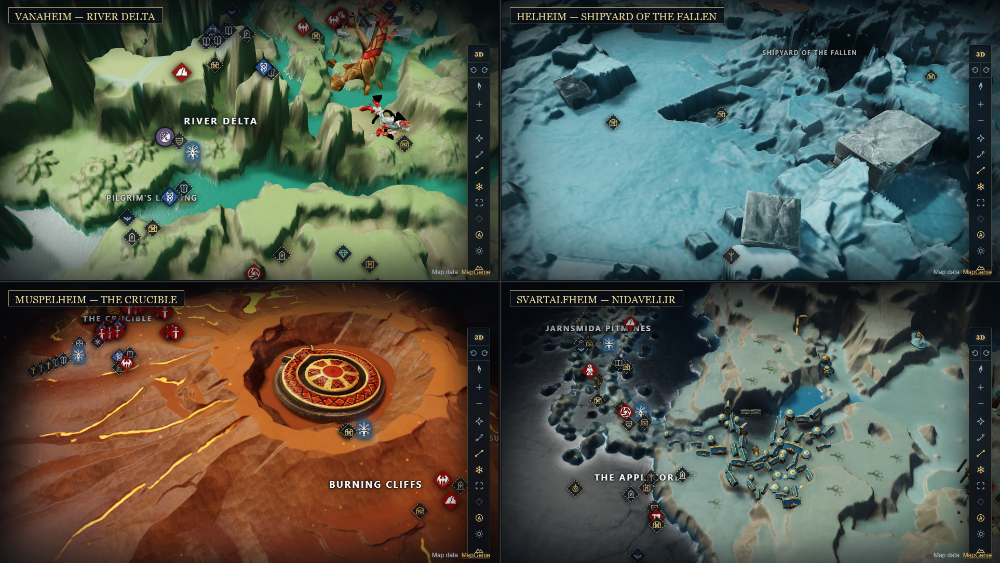
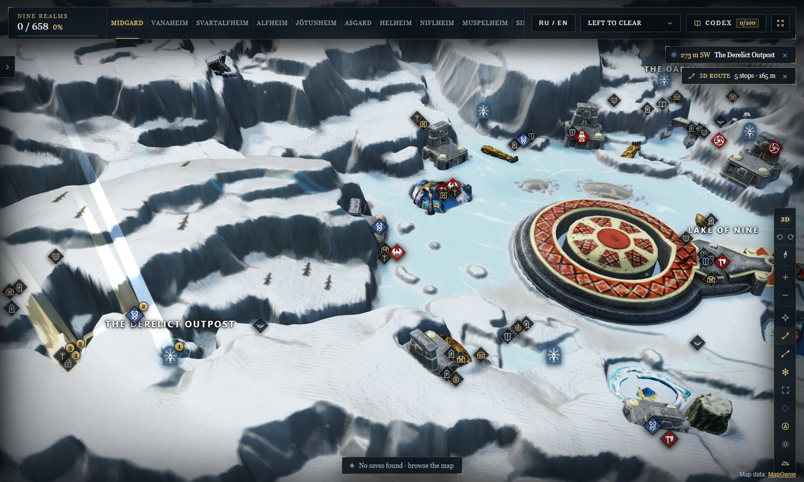
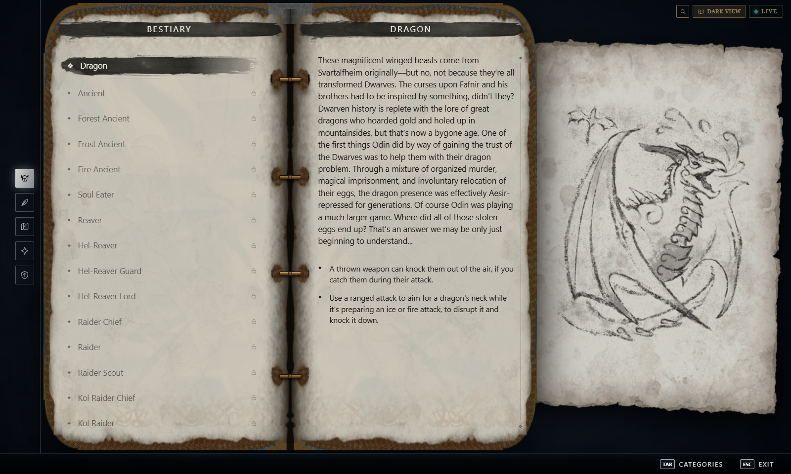

# God of War Ragnarök — Карта-компаньон

[English](README.md) · **Версия 0.5.0** · Лицензия MIT · Руководства в Steam: [Русское](https://steamcommunity.com/sharedfiles/filedetails/?id=3840415927) · [English](https://steamcommunity.com/sharedfiles/filedetails/?id=3840431796)

Полноэкранная **родная 3D-карта из самой игры**, **универсальный 3D-навигатор** и **живой Кодекс / Бестиарий в виде раскрытой книги** для Steam-версии **God of War Ragnarök (PC)** — для второго монитора, планшета или телефона по Wi-Fi/LAN без внешних веб-зависимостей.


> *На скриншотах — работа программы на ПК пользователя с локально извлечёнными из установленной копии игры данными и публичными координатами меток MapGenie. Сейвы, личные данные и игровые ассеты в репозиторий не входят. Права на графику и карту принадлежат их правообладателям.*

---

## Возможности в действии

### Все 9 миров в родном 3D (реконструкция игровой диорамы)

При наличии установленной Steam-версии **God of War Ragnarök** компаньон воссоздаёт оригинальную резную 3D-карту из самой игры для всех 9 миров: реальные 3D-модели ориентиров и зданий, PBR-атласы (диффуз + нормали + глянец + альфа-вырезка листвы), 2K-тени скал с трассировкой лучей, реалтайм 2048px карту теней, анимированные потоки рек и раскалённой лавы, резные деревья, объёмный туман и 3D-погоду каждого мира.



### Универсальные 3D-маршруты, зачистка и встроенные гайды

Прокладывайте золотой 3D-маршрут по рельефу к **любой цели** — сундуку Норн, Ворону Одина, точке Просьбы, кладу или боссу — прямо от живого Кратоса (обновляется на ходу) либо от ближайших открытых Мистических врат, включая автоматический переход в другой мир. Клавиша **M** строит **3D-маршрут зачистки** до 5 ближайших несобранных меток, а **N** зажигает 3D-маяк на ближайшем пропущенном предмете.



### Живой Кодекс и Бестиарий в виде игровой книги

Клавиша **K** (или кнопка **Кодекс**) открывает аутентичный разворот кожаного переплёта с пергаментными страницами (есть переключение **Книга / Тёмный** в 1 клик): полный **Бестиарий** (198 записей + переключатель DLC Вальхалла, 9 категорий, боевые советы, счётчики убийств, оригинальные чернильные эскизы на откидном листе), **Легенды** (~209 записей), **Сокровища** (все 10 карт сокровищ со статусами из сейва, загадками, рисунками-подсказками и кнопками маршрута к свитку и к кладу), **Навыки и Труды** (49 навыков + блок *«Почти готово»*) и **Снаряжение / материалы крафта**. Встроенный **Антиспойлер** скрывает неоткрытые записи, а поток Server-Sent Events (`/api/stream`) мгновенно присылает уведомления на планшет сразу после автосохранения игры.



---

## Как это устроено

Компаньон запускает локальный Python-сервер (`server.py`, строго только на чтение), который собирает три слоя полностью на вашем ПК:

1. **Родная 3D-диорама игры (локальное чтение без изменения файлов)**
   - Читает `exec/wad/pc_le/r_ui.wad`, `root.lodpack` и `root.texpack` из вашей установленной Steam-копии игры — в папку игры **ничего и никогда не записывается**.
   - Извлекает 3D-геометрию ориентиров (`MESH_<мир>_0` → компактный бинарный `props.bin` с жёсткой кластерной посадкой на рельеф), собирает синхронизированные PBR-атласы (`atlas.png` в `RGBA` с точной альфа-вырезкой листвы и цветов + `atlas_n.png` с картами нормалей и глянца), декодирует карты высот BC6H в 16-битный `1024×1024` GPU-рельеф (`<мир>_h16.png`) и рендерит 2K-поверхности с 36-шаговыми тенями скал и масками воды/лавы.
   - Автоматически отдаёт текстуры в **WebP + gzip** (~4.6 МБ на мир вместо ~22 МБ PNG) для быстрой и плавной работы на планшетах и телефонах по Wi-Fi.
   - Весь кэш хранится только в **`%LOCALAPPDATA%\gowr-companion-map\cache\`**. Если игра не найдена (или в Доме Синдри), движок автоматически переключается на тайлы MapGenie с процедурным микрорельефом; режимы **Родное 3D / MapGenie** можно переключать кнопкой на правой панели.
2. **Синхронизация сохранений, гайды и локализация**
   - Координаты меток один раз скачиваются с MapGenie в локальный кэш и сверяются с вашими сохранениями Steam по числовым правилам флагов (`data/`).
   - Официальные русские и английские названия меток и регионов извлекаются локально из ваших `r_lang_en.wad` и `r_lang_ru.wad` по общим ID строк.
   - Встроенный русский перевод описаний (`data/ru_descriptions.json`, все 1 171 метка с описанием) и RU/EN гайды (`data/guides.json` — все 35 сундуков Норн, 52 сложных коллекционных предмета и 47 Просьб с 77 точками «куда идти») работают офлайн из коробки.
3. **Живой Кратос и реалтайм-поток SSE**
   - При запущенной подтверждённой сборке игры `gow_memory.py` открывает `GoWR.exe` строго на чтение (`PROCESS_VM_READ | PROCESS_QUERY_INFORMATION`, `0x0410`), показывая живой маркер Кратоса, конус камеры, 3D-след пути и всплывающие подсказки гайдов рядом (~30 м).
   - Поток `/api/stream` в реальном времени пушит телеметрию, обновления сейва и новые записи Кодекса на все подключённые экраны.

---

## Требования

- **ОС и Python**: Windows 10 или 11, 64-битный **Python 3.11 или новее** (команда `py` или `python` в PATH).
- **Игра**: Steam-версия **God of War Ragnarök** для родной 3D-карты, прогресса из сейвов, Кодекса, локализации и живой позиции. Смотреть карту можно и при закрытой игре.
- **Сеть**: Интернет при первом запуске для установки Python-пакетов (`numpy`, `Pillow`, `lz4`, `imagecodecs`) и разовой загрузки публичных меток MapGenie. Аккаунты, API-ключи и платные сервисы не нужны.
- **Браузер**: Любой современный браузер с WebGL2 на ПК, Android-планшете/телефоне (Chrome, Firefox) или iPad/iPhone.

> **Подтверждённая сборка живой позиции**: встроенный профиль `KNOWN_BUILDS` проверен на **GoWR.exe размером 46 685 144 байта, PE timestamp 1 750 707 527 (`0x6859AD47`)** (идентификатор сборки, не дата релиза) с проверкой заголовков загруженного модуля. На незнакомом патче маркер Кратоса безопасно скрывается, а 3D-карта, сейвы, маршруты и Кодекс продолжают работать.

---

## Быстрый старт и настройка

### 1. Запуск на ПК (в один клик)

1. Скачайте ZIP-архив репозитория и распакуйте его, либо выполните `git clone`.
2. Дважды кликните **`start.bat`**.
   - При первом запуске скрипт сам создаст `.venv`, установит `requirements.txt` (`numpy`, `Pillow`, `lz4`, `imagecodecs`), скачает публичные метки MapGenie в `%LOCALAPPDATA%\gowr-companion-map\` и откроет **http://127.0.0.1:8790/**.
   - Оставьте окно терминала открытым во время игры; для остановки нажмите **Ctrl+C**.
3. **Первая сборка родного 3D**: при первом открытии любого мира его 3D-диорама автоматически собирается за ~8–10 секунд и сохраняется в локальный кэш — все последующие открытия мгновенны.

### 2. Предсборка всех 9 миров сразу (необязательно, рекомендуется)

Чтобы не ждать ~8 секунд при первом переключении каждого мира (особенно перед игрой с планшетом), можно заранее собрать все 9 миров одной командой (~90 секунд):

```bat
.venv\Scripts\python.exe tools\gow_native_map_3d.py
```

### 3. Планшет, телефон или второй экран (Wi-Fi / LAN)

Запустите с флагом `--lan`:

```bat
start.bat --lan
```

1. Если Windows Firewall спросит разрешение — разрешите Python доступ в **Частной сети (Private)**.
2. Откройте адрес **`LAN: http://<IP-вашего-ПК>:8790/`** из терминала в браузере планшета или телефона в той же Wi-Fi сети.
3. Нажмите кнопку **На весь экран** (правый верхний угол) и **Не гасить экран (Wake Lock)** внизу правой панели. Страницу также можно добавить на главный экран как PWA-приложение.

> **Безопасность**: обычный запуск слушает только `127.0.0.1`. Режим `--lan` открывает доступ в локальной сети без пароля — используйте его только в домашней сети и не пробрасывайте порт `8790` в интернет. API никогда не отдаёт пути к сейвам Windows и ID аккаунтов Steam.

### 4. Свои папки игры / сейвов и все параметры запуска

Библиотеки Steam и папка Saved Games (включая перенаправленные папки и подпапки аккаунтов) определяются автоматически. При необходимости всё можно задать вручную:

| Флаг / Переменная | Назначение |
|---|---|
| `start.bat --lan` | Открыть карту и Кодекс для планшетов и телефонов в локальной сети |
| `start.bat --port 8791` | Сменить порт сервера (по умолчанию `8790`) |
| `start.bat --game-dir "<папка>"` | Указать папку установленной игры вручную |
| `start.bat --save-dir "<папка>"` | Указать папку сохранений вручную |
| `start.bat --lang ru` / `--lang en` | Язык сообщений в терминале (язык UI переключается кнопкой **RU / EN**) |
| `start.bat --no-browser` | Запустить сервер без автоматического открытия вкладки на ПК |
| `start.bat --offline` | Работать только по локальному кэшу без сетевых запросов |
| `start.bat --autocalib` | Включить опциональную автокалибровку по экрану (см. ниже) |
| `GOWR_DATA_DIR=<папка>` | Переменная среды для переноса кэша из `%LOCALAPPDATA%\gowr-companion-map\` |

---

## Управление и жесты

| Ввод | Действие |
|---|---|
| **ЛКМ + тянуть** / **1 палец** | Перемещение по 3D-земле (без дрейфа, как в Google Maps) |
| **Колесо мыши** / **щипок 2 пальцами** | Приближение и отдаление |
| **ПКМ** или **Ctrl + тянуть** / **поворот 2 пальцами** | Вращение камеры вокруг оси |
| **ПКМ вверх-вниз** / **2 пальца вверх-вниз** | Изменение угла наклона 3D-камеры (`0°`–`62°`) |
| **T** / кнопка **3D** | Переключение 3D-диорамы и плоского вида сверху |
| **[** / **]** / клик по компасу | Поворот камеры влево/вправо / сброс на север |
| **N** / кнопка **Ближайшая** | Переход к ближайшей пропущенной метке + 3D-маяк (автопереход после сбора) |
| **M** / кнопка **3D-маршрут** | 3D-маршрут зачистки до 5 ближайших несобранных меток |
| **K** / кнопка **Кодекс** | Открыть / закрыть книгу Кодекса и Бестиария |
| **C** / **R** | Центрировать на живом Кратосе / показать весь мир |
| **U** / **Tab** / **1–0** | Фильтр зачистки / свернуть левую панель / переключение миров |
| **Полный экран** / **Wake Lock** / **Погода** / **Источник** | Кнопки шапки и правой панели (включая переключение **Родное 3D / MapGenie**) |
| **Геймпад** | Крестовина — HUD, LB/RB — зум, правый стик — поворот и наклон 3D, A/B — выбор/назад |

Ручные отметки сохраняются отдельно в `localStorage` каждого браузера и никогда не меняют файлы сохранений.

---

## Данные, кэш и приватность

- Все скачанные данные MapGenie, извлечённая локализация, 16-битные карты высот, родные 3D-сцены, WebP-кэши и иконки Кодекса хранятся строго в **`%LOCALAPPDATA%\gowr-companion-map\`** (или `GOWR_DATA_DIR`).
- В репозитории находятся только исходный код, числовые сопоставления меток и флагов сейва, калибровочные матрицы, авторские гайды (`data/guides.json`) и русский перевод названий/описаний. Игровых файлов, текстур, сейвов и личных идентификаторов в нём **нет**.
- Если загрузка меток MapGenie сорвалась из-за сети, повторите только неудавшиеся миры:

```bat
.venv\Scripts\python.exe tools\fetch_mapgenie.py --retry
```

---

## Живая позиция после патчей и опциональная автокалибровка

### Поиск указателей после нового патча игры (для опытных)

После обновления `GoWR.exe` живой маркер автоматически скрывается, не мешая остальным функциям. Продвинутые пользователи могут запустить встроенный **анализатор и пробник строго на чтение**:

```bat
.venv\Scripts\python.exe tools\analyze_gowr_binary.py --exe "<папка игры>\GoWR.exe"
.venv\Scripts\python.exe tools\gow_live_pointer_probe.py
```

Результаты сохраняются в подпапку `probe` пользовательского каталога (ничего автоматически не включается и никуда не отправляется). Проверьте подтверждённые кандидаты позиции/угла перед обновлением `KNOWN_BUILDS` в `gow_memory.py`.

### Опциональная автокалибровка по экрану (`--autocalib`)

По умолчанию выключена. Требует дополнительные пакеты (`opencv-python`, `mss`):

```bat
.venv\Scripts\python.exe -m pip install -r requirements-optional.txt
.venv\Scripts\python.exe tools\gow_auto_calibrate.py --learn-templates
start.bat --autocalib
```

При запуске `--learn-templates` переключитесь на открытую карту в игре за 5 секунд, выделите подсвеченную вкладку **КАРТА** и круглый значок Кратоса, подтверждая каждое выделение клавишей Enter. Шаблоны и реперы хранятся только в пользовательском кэше и не затрагивают файлы репозитория.

---

## Разработка и тестирование

```bat
python -m pip install -r requirements-dev.txt
python -m pytest -q
python tools\check_clean.py
```

- Все 85 тестов выполняются полностью офлайн на синтетических картах, сгенерированных сейвах и матрицах — установленная игра и реальные сейвы для тестов не нужны. UI-тесты Chromium запускаются при установленном Playwright (`python -m playwright install chromium`).
- `tools/check_clean.py` проверяет каждый отслеживаемый git-файл (включая текстовые метаданные PNG и документацию) на отсутствие личных сигнатур, абсолютных путей Windows, ID аккаунтов, ключей и запрещённых файлов.

---

## Поддержать проект

Карта-компаньон бесплатна и открыта. Если она помогла закрыть Девять миров на 100% без лишних пауз — можно поддержать автора: каждый донат идёт в разработку новых бесплатных утилит для игр и оплату ИИ-подписок, с которыми они создаются:

- **Банка monobank** (карты любых стран, Apple Pay, Google Pay) — <https://send.monobank.ua/jar/3zsHTXdRbt> · карта банки `4874 1000 3320 3608`
- **PayPal** — [реквизиты на странице поддержки](https://alexsander720.github.io/continue/#support)
- **USDT · TRC20** (Tron) — `TKhmtVEnuU5w73YMPT8adh7t3VZKJUUxmC`
- **USDT · BEP20** (BNB Smart Chain) — `0xDC0c682922bF3194693774743fBB3fd20E7754c3`

---

## Отказ от ответственности и лицензия

Неофициальный фан-проект, не связан с **Sony Interactive Entertainment, Santa Monica Studio или MapGenie** и не одобрен ими. *God of War Ragnarök*, связанные названия и графика принадлежат их правообладателям. Память и файлы игры открываются **строго на чтение** — в игру и сейвы ничего не записывается.

Координаты меток скачиваются локально с [MapGenie](https://mapgenie.io/god-of-war-ragnarok) на ПК пользователя по условиям MapGenie. Репозиторий не предоставляет права на распространение извлечённых игровых ассетов или сторонних данных.

Исходный код программы и наши оригинальные сопоставления распространяются под [лицензией MIT](LICENSE).
