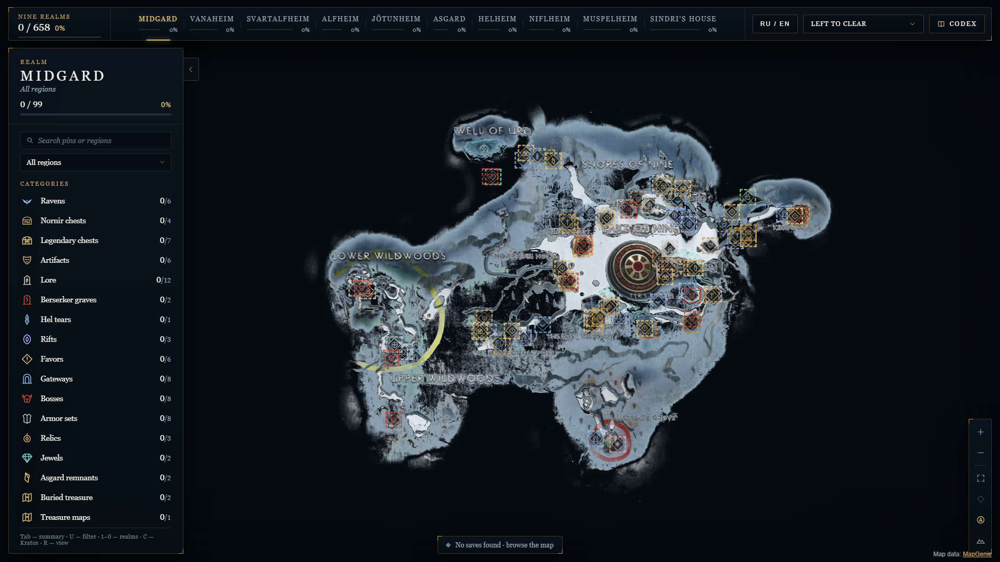

# God of War Ragnarök — Карта-компаньон

[English](README.md) · Версия 0.1.1 · Руководство в Steam: [русское](https://steamcommunity.com/sharedfiles/filedetails/?id=3840415927) · [английское](https://steamcommunity.com/sharedfiles/filedetails/?id=3840431796)

Полноэкранная карта для второго экрана в **God of War Ragnarök, Steam, PC**. Девять миров и Дом Синдри, метки и описания, просьбы из журнала, прогресс по сохранению и живой Кратос там, где подтверждены версия игры и проекция координат.



На снимке — интерфейс программы с данными, скачанными в локальный кэш. Сейв и кадр игры в репозиторий не входят. Изображения карты, видимые в программе, принадлежат MapGenie и правообладателям игры.

## Требования

- Windows 10/11, 64-битный Python 3.11 или новее; доступна команда `py` или `python`.
- Steam-версия God of War Ragnarök для чтения сохранений, памяти и локализации. Карту можно смотреть и при закрытой игре.
- Интернет для установки Python-пакетов, первоначальной загрузки меток и подгрузки тайлов. Аккаунты, API-ключи и платные сервисы не нужны.
- Современный браузер; для второго экрана подойдёт телефон в той же локальной сети.

Включённый профиль `KNOWN_BUILDS` был проверен в исходной реализации на **GoWR.exe размером 46 685 144 байта, PE timestamp 1 750 707 527 (`0x6859AD47`)**. Timestamp — идентификатор сборки, а не дата её выхода. Дополнительно проверяется заголовок загруженного модуля. Другие патчи этим профилем не подтверждены. Живой прогон на чистой машине для этого релиза пока не выполнен.

## Запуск

1. Скачайте ZIP с исходниками и распакуйте его либо клонируйте репозиторий.
2. Запустите **`start.bat`**. Он создаст `.venv`, установит `requirements.txt`, скачает общедоступные данные карты в вашу пользовательскую папку и откроет браузер.
3. Адрес по умолчанию: **http://127.0.0.1:8790/**. Оставьте терминал открытым. Для остановки сервера нажмите Ctrl+C.

Игра ищется через настройки Steam в реестре, `libraryfolders.vdf` и манифест приложения. Если автопоиск не сработал, откройте терминал в папке проекта:

```bat
start.bat --game-dir "<папка установленной игры>"
```

Сохранения ищутся в Saved Games текущего пользователя Windows, включая перенаправленную системную папку и подпапки разных аккаунтов. Файлы открываются только на чтение. Нужную папку можно указать явно: `--save-dir "<папка сохранений>"`.

Начальный язык определяется браузером. Кнопка **RU / EN** переключает интерфейс и запоминает выбор в `localStorage`. Русские имена меток и регионов извлекаются из ваших `r_lang_en.wad` и `r_lang_ru.wad`: английская строка сопоставляется с русской по общему ID. Если нужных файлов или строки нет, остаётся английское имя. Описания меток — в английском оригинале и в нашем русском переводе (`data/ru_descriptions.json`, все 1171 метка с описанием на ноябрь 2026): в карточке метки переключатель **Оригинал / Перевод**, при русском интерфейсе по умолчанию перевод. Метки, добавленные на MapGenie позже перевода, показываются в оригинале. Ссылки на другие места открывают соответствующие метки этой карты.

## Телефон и второй экран

```bat
start.bat --lan
```

Откройте адрес LAN, напечатанный в терминале, на устройстве в той же сети. Если Windows спросит, разрешите Python работать в частной сети. Обычный запуск слушает только loopback; `--lan` открывает все локальные интерфейсы. У LAN-сервера нет авторизации: используйте доверенную домашнюю сеть и не выставляйте порт в интернет. Подключённые устройства видят прогресс и журнал просьб; пути к сейвам и папки аккаунтов API не отдаёт.

Дополнительные параметры:

```bat
start.bat --port 8791
start.bat --offline
start.bat --no-browser
start.bat --lang ru
```

`--lang` задаёт язык терминала; язык интерфейса выбирает браузер. `--offline` использует только уже сохранённые метки и тайлы, без сетевых запросов. Участки карты, тайлы которых ещё не загружались, останутся без подложки.

## Работа с картой

- **Осталось зачистить** — несобранные и неизвестные зачётные метки. **Все зачётные** — также собранные места. **+ Сундуки с ресурсами** — ещё и мелкая добыча без индивидуальных флагов.
- **Просьбы** — активные просьбы журнала и известные оставшиеся места во всех мирах. Счётчик выводится только при подтверждённом значении из сейва. Неизвестное место текущего шага так и подписывается.
- Доступны вкладки миров, категории, регионы, поиск, масштабирование, перетаскивание и панель метки. На телефоне работают перетаскивание и масштабирование двумя пальцами; сводка при первом открытии свёрнута.
- **C** — к Кратосу, **R** — весь мир, **U** — фильтр зачистки, **Tab** — сводка, **1–0** — миры. Есть управление клавиатурой и геймпадом.
- Ручные отметки хранятся в `localStorage` этого браузера. Сейв и журнал просьб они не меняют. На другом телефоне или в другом браузере отметки независимы.
- **Кодекс** показывает доступные сведения из сохранения. Прогресс обновляется после записи автосейва игрой; это не непрерывное чтение инвентаря.

## Данные, кэш и приватность

Загруженные метки и тайлы, извлечённые строки, дополнительный рельеф и результаты калибровки находятся в **`%LOCALAPPDATA%\gowr-companion-map\`**. Для другой папки задайте перед запуском переменную `GOWR_DATA_DIR`, например `./cache/user`. Файлы времени выполнения исключены через `.gitignore`; не помещайте пользовательский каталог в отслеживаемые папки исходников.

В репозитории лежат код программы, наши числовые сопоставления меток и сейва, измеренные реперы и матрицы. Дампов MapGenie, выгрузок строк игры, извлечённых текстур, сохранений, личных аккаунтов и кэша тайлов в нём нет. Браузерный растровый движок — локальный код приложения, внешняя CDN-библиотека ему не нужна. Python-зависимости устанавливаются отдельно и сохраняют свои лицензии.

Загрузчик делает один запрос общедоступных данных на каждый мир без кэша, использует нейтральный User-Agent и сохраняет результат. Сейчас сайт получает метки через `/api/v1/maps/<id>/data`; полный список локаций в HTML больше не встроен. В загрузчике также есть разбор старого встроенного JSON `window.mapData`. Данные источника меняются независимо от версии программы; у новых меток без нашего правила сверки статус останется неизвестным.

При сетевой ошибке или проверке доступа программа запускается без соответствующих меток. Решения CAPTCHA, автоматического входа и обхода защит нет. Ошибки запоминаются, чтобы не повторять запросы при каждом запуске. После проверки связи повторите неудачные загрузки:

```bat
.venv\Scripts\python.exe tools\fetch_mapgenie.py --retry
```

Успешно сохранённые миры останутся в кэше. Тайлы загружаются по мере просмотра и сохраняются; отсутствие тайла также кэшируется. Описания, которых нет в готовом переводе, показываются в оригинале. Программа не загружает фотографии меток и не копирует игровые скриншоты.

## Живой Кратос и патчи игры

Процесс открывается с правами **`PROCESS_VM_READ | PROCESS_QUERY_INFORMATION` (`0x0410`)**. Программа не пишет в память игры, сейвы или каталог установки. При неизвестной или непроверяемой сборке живой маркер скрывается, выводится статус версии; карта и чтение сохранений продолжают работать. Маркер также скрыт за пределами доступной проекции. Приближённое положение явно помечается.

Положение берётся из проверенной цепочки указателей; конус показывает направление камеры. Некоторые миры и отдельные вставки карты ещё не откалиброваны. Географически разные места могут быть нарисованы рядом, поэтому одна матрица не обязана подходить всему миру. Сейв не всегда различает отдельные драугрские ямы и сезонных оленей. Связь метки с просьбой сама по себе не подтверждает выполнение места.

После патча сначала проверьте обновления профиля карты. Опытные пользователи могут собрать новый список кандидатов и запустить включённый **пробник только для чтения**:

```bat
.venv\Scripts\python.exe tools\analyze_gowr_binary.py --exe "<папка игры>\GoWR.exe"
.venv\Scripts\python.exe tools\gow_live_pointer_probe.py
```

Пробник просит постоять, пройти и отдельно повернуть камеру. Результаты сохраняются в подпапку `probe` пользовательского каталога. Параметры отдельных снимков, сравнения, `--confirm-position` и `--confirm-yaw` перечислены в `--help`. Рейтинг кандидатов — гипотеза: независимо подтвердите, что выбран именно Кратос, проверьте результат, затем используйте напечатанную конфигурацию для обновления `KNOWN_BUILDS` в `gow_memory.py`. Автоматического включения кандидатов и отправки результатов нет. Личные снимки памяти и списки строк бинарника публиковать не следует.

## Необязательные рельеф и автокалибровка

Обычный запуск эти возможности не включает. Установите дополнительные зависимости в то же окружение:

```bat
.venv\Scripts\python.exe -m pip install -r requirements-optional.txt
```

Извлеките рельеф из своей установки. Интерфейс предлагает только карты с принятой географической привязкой:

```bat
.venv\Scripts\python.exe tools\gow_game_map.py midgard --size 2048
```

При необходимости добавьте `--game-dir "<папка игры>"`. Перезапустите сервер после извлечения. Переключатель появляется только при наличии файлов и принятой привязки; в 0.1.0 принят Midgard. Дополнительная зависимость `imagecodecs` декодирует высоты BC6H с полной точностью; исходник чужого декодера и игровые текстуры в репозиторий не включены.

Перед первым использованием откройте карту в игре и запустите разовое обучение шаблонов:

```bat
.venv\Scripts\python.exe tools\gow_auto_calibrate.py --learn-templates
```

За пять секунд переключитесь в игру. В двух окнах выделения выберите подсвеченную вкладку **КАРТА**, затем квадрат вокруг круглого значка Кратоса; каждое выделение подтвердите Enter. В пользовательский кэш сохраняются только два этих фрагмента. Они относятся к вашей установке игры: их нельзя коммитить или перепубликовывать. Повторите настройку при смене языка или вида игрового интерфейса. Без личных шаблонов сборщик остаётся выключенным и сообщает о необходимости настройки.

Затем включите автокалибровку явно:

```bat
start.bat --autocalib
```

Откройте карту игры, стоя на месте. Сборщик читает изображение активного окна игры, сопоставляет карту с кэшированными/загруженными тайлами и сохраняет принятые реперы в пользовательский `live_realm_refs.json`. Базовые реперы сохраняются; файл калибровки в репозитории не меняется. Захват используется только при `--autocalib` или явно запущенном обучении `--learn-templates`. Алгоритм покрыт синтетическими проверками; живой прогон на чистой машине пока не проверялся.

## Разработка и проверка

```bat
python -m pip install -r requirements-dev.txt
python -m pytest -q
python tools\check_clean.py
```

Тесты используют синтетические метки, сгенерированные байты сохранений и наши матрицы. Внешние запросы отключены; реальная игра и сейвы не нужны и не читаются. Рендер Chromium запускается при наличии Playwright и его браузера, иначе явно пропускается. Установка тестового браузера: `python -m playwright install chromium`.

`check_clean.py` проверяет **все отслеживаемые git-файлы**, включая документацию: личные сигнатуры, абсолютные пути Windows, идентификаторы аккаунтов, шаблоны ключей и запрещённые данные. Перед проверкой добавьте предназначенные для релиза файлы в индекс. Чистый сканер не заменяет ревью происхождения данных.

## Отказ от ответственности и лицензия

Неофициальный фан-проект, не связан с **Sony Interactive Entertainment, Santa Monica Studio или MapGenie** и не одобрен ими. God of War Ragnarök, связанные названия и изображения принадлежат соответствующим правообладателям. Память игры только читается; в игру ничего не записывается.

Данные карты скачиваются с [MapGenie](https://mapgenie.io/god-of-war-ragnarok) на компьютере пользователя и подпадают под условия MapGenie. Репозиторий не предоставляет права перепубликовывать скачанные или извлечённые материалы. Приложение и дополнительные инструменты чтения памяти используются на ваше усмотрение.

Код программы и наши сопоставления предоставлены по [лицензии MIT](LICENSE). Она не распространяется на данные сторонней карты, файлы игры, изображения внутри снимка программы и установленные Python-зависимости.
